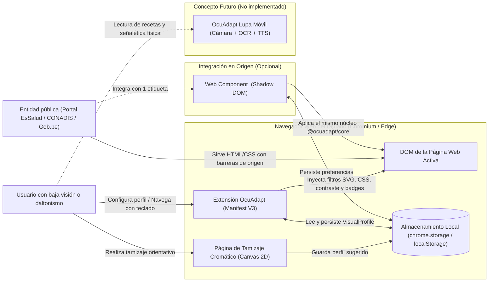
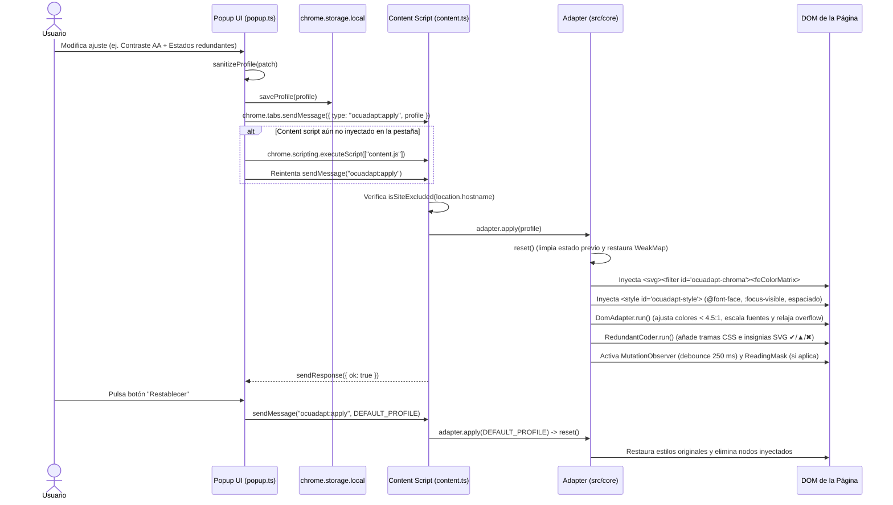
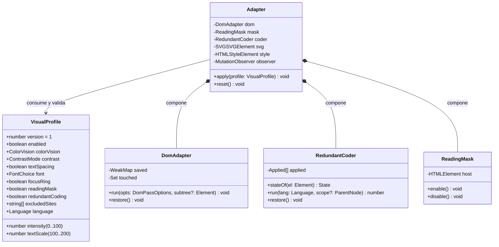
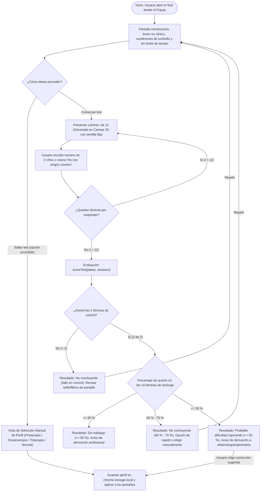
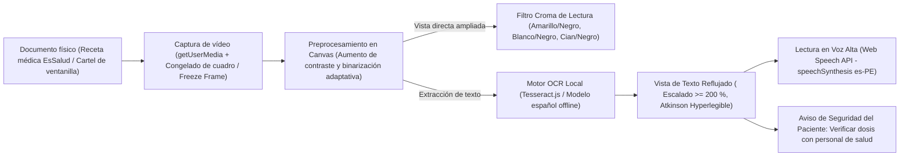
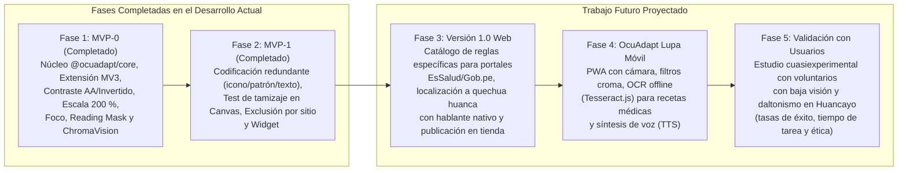

# Documentación Técnica del Desarrollo – Capítulo VII: Propuesta de Remediación e Innovación Tecnológica (OcuAdapt)

**Proyecto:** Ecosistema de Adaptación Visual *OcuAdapt* y Motor Cromático *ChromaVision Engine*  
**Asignatura:** Discapacidad y Accesibilidad (IS066B) – UNCP  
**Caso de estudio:** EsSalud – Hospital Nacional Ramiro Prialé Prialé (Huancayo) y portales conexos  
**Fecha:** 09/11/2026  

---

## 7.1 Propósito, alcance y límites de la propuesta

La presente propuesta tecnológica responde al cuarto objetivo específico del estudio: relacionar las barreras documentadas durante la inspección diagnóstica con una solución informática factible y definir el protocolo técnico para comprobar su utilidad. El sistema desarrollado, denominado **OcuAdapt**, constituye un ecosistema de adaptación visual de doble capa (extensión de navegador para el usuario final y componente web integrable para entidades públicas) construido en torno a un núcleo compartido libre de dependencias externas.

El diseño se rige por cuatro límites técnicos y normativos explícitos:

1. **Mitigación en el cliente frente a conformidad en origen:** La extensión de navegador actúa sobre el modelo de objetos del documento (DOM) en el dispositivo del usuario para mitigar barreras de contraste, escala, foco y codificación cromática detectadas en la muestra. Esta adaptación **no otorga conformidad con las pautas WCAG 2.2 al portal intervenido** ni sustituye la obligación de la entidad titular de corregir su código fuente. Por ello, el ecosistema acompaña la extensión con el componente `<ocuadapt-widget>` y lineamientos de tokens de diseño para facilitar la remediación institucional.
2. **Alcance no clínico:** Ni los filtros de recromatización ni el módulo de tamizaje visual constituyen dispositivos médicos ni herramientas de diagnóstico oftalmológico u optométrico. La daltonización algorítmica redistribuye diferencias cromáticas hacia canales perceptibles para mejorar la discriminación de elementos de interfaz, pero **no restablece la visión normal del color** (Male et al., 2022).
3. **Frontera entre barreras digitales y físicas:** Las barreras arquitectónicas y de señalética física documentadas en el Hospital Nacional Ramiro Prialé Prialé (ausencia de franjas contrastadas en peldaños, carencia de pisos podotáctiles y reflejos por iluminación sobre superficies pulidas) no son resolubles mediante software de navegador y se derivan a las recomendaciones de infraestructura bajo la Norma Técnica A.120. El módulo móvil de lectura asistida (*OcuAdapt Lupa*) se plantea únicamente a nivel conceptual como apoyo frente a impresos y cartelería.
4. **Privacidad y ejecución local (*local-first*):** En cumplimiento de la Ley N.° 29733 (Ley de Protección de Datos Personales), toda preferencia visual o resultado orientativo de tamizaje se procesa y almacena exclusivamente en el navegador del usuario, sin telemetría ni transmisión a servidores externos.

---

## 7.2 Matriz de trazabilidad: barrera documentada → función de software

Toda funcionalidad implementada o proyectada en **OcuAdapt** responde de forma directa a una barrera registrada en los capítulos de diagnóstico. En la **Tabla 7.1** se establece la trazabilidad completa entre los hallazgos, la viabilidad de abordaje mediante software cliente, el módulo responsable, el criterio WCAG 2.2 aplicable y la prueba de verificación correspondiente.

**Tabla 7.1**  
*Matriz de trazabilidad entre barreras documentadas, funciones del sistema OcuAdapt y pruebas de verificación*

| ID | Barrera documentada | Evidencia de origen | ¿Abordable en cliente? | Función propuesta en OcuAdapt | Estado de desarrollo | Criterio WCAG 2.2 / Norma | Prueba de verificación |
|---|---|---|---|---|---|---|---|
| **B1** | Texto gris claro (`rgb(159,159,159)`) sobre fondo blanco con razón de contraste de $2.65:1$ | Auditoría web (Campus Virtual CONADIS: 11 errores WAVE) | Sí | Motor de contraste adaptativo (`DomAdapter`): ajuste automático del color de primer plano a $\ge 4.5:1$ | **Implementado (MVP-0)** | 1.4.3 (AA), 1.4.6 (AAA) | **T1:** Medición de luminancia antes/después y auditoría integrada |
| **B2** | Contraste insuficiente ($2.94:1$) en bloques informativos y enlaces | Auditoría web (Portal Hospital Alcides Carrión: 17 errores WAVE) | Sí | Motor de contraste adaptativo (`DomAdapter`) y modo de polaridad invertida ($\ge 7:1$) | **Implementado (MVP-0)** | 1.4.3 (AA), 1.4.6 (AAA) | **T1:** Recuento de textos con razón $< 4.5:1$ antes y después |
| **B3** | Pérdida de visibilidad del formulario de acceso al aplicar zoom del $200\%$ | Auditoría web (Campus Virtual CONADIS) | Parcial | Escalado fluido de texto ($100\%$–$200\%$), espaciado WCAG 1.4.12 y relajación automática de contenedores con recorte (`relaxClipping`) | **Implementado (MVP-0)** | 1.4.4 (AA), 1.4.10 (AA), 1.4.12 (AA) | **T2:** Verificación de visibilidad del botón de envío a escala $200\%$ |
| **B4** | Ausencia de indicador visual de foco al navegar con la tecla `Tab` | Auditoría web (Campus Virtual CONADIS) | Sí | Inyección de anillo de foco reforzado (`3px solid #ffd400` con doble contorno negro y margen de desplazamiento `scroll-padding`) | **Implementado (MVP-0)** | 2.4.7 (AA), 2.4.11 (AA) | **T3:** Recorrido secuencial con `Tab` y comprobación de regla `:focus-visible` |
| **B5** | Imágenes con enlace carentes de atributo de texto alternativo (`alt`) | Auditoría web (54 de 58 errores WAVE en portal hospitalario) | Limitado | Fuera del alcance del MVP; la descripción semántica fiel exige remediación en el servidor de origen | **Derivado a recomendación en origen** | 1.1.1 (A), 2.4.4 (A) | **T5:** Documentado como límite técnico del lado del cliente |
| **B6** | Estados de atención, turnos o trámites diferenciados únicamente por color (semáforo rojo/ámbar/verde) | Cap. II (escenarios funcionales) y Cap. VI (Tabla 9) | Sí (en web, por reglas) | Motor *ChromaVision* (daltonización LMS en SVG) + codificador redundante (`RedundantCoder`: icono geométrico + trama CSS + etiqueta textual) | **Implementado (MVP-0 / MVP-1)** | 1.4.1 (A) | **T4:** Prueba «sin color» (presencia de icono/etiqueta) y distancia cromática bajo simulación |
| **B7** | Señalética física hospitalaria con encabezados de bajo contraste y tipografía reducida en recetas/citas | Cap. IV (Figs. 4–6, Hospital Ramiro Prialé Prialé) | No en web; apoyo móvil conceptual | Concepto *OcuAdapt Lupa*: captura por cámara, filtros croma de alto contraste, OCR y lectura en voz alta (TTS) | **Conceptual (Fase futura)** | RNE A.120 (físico) | Diseño conceptual y advertencias de seguridad del paciente |
| **B8** | Peldaños sin franja contrastada en nariz de grada, ausencia de guía podotáctil y reflejos en piso | Cap. VI (Figs. 8–10, recorrido físico hospitalario) | No | Fuera del alcance de software; corresponde a adecuación de infraestructura física | **Derivado a recomendación (Cap. VI)** | RNE A.120 | — |
| **B9** | Comunicados o requisitos publicados como texto incrustado dentro de imágenes | Hipótesis diagnóstica de canales digitales estatales | Parcial | Propuesta conceptual de extracción óptica (OCR) sobre imágenes en fases posteriores; recomendación de publicar HTML semántico | **Conceptual** | 1.4.5 (AA), 1.1.1 (A) | — |
| **B10** | Unidades de transporte urbano identificadas por franjas de color sin numeración legible a distancia | Cap. VI (Tabla 9, entorno urbano de Huancayo) | No | Recomendación de regulación y señalética vehicular | **Derivado a recomendación** | Ley N.° 29973 | — |

*Nota.* Elaboración propia a partir de los hallazgos de diagnóstico y la implementación del sistema.

---

## 7.3 Concepto del sistema y principios de diseño

**OcuAdapt** es un sistema de asistencia visual para entornos web que permite a personas con baja visión o deficiencias en la percepción del color (protanopia, deuteranopia y tritanopia) personalizar la presentación de portales informativos y de trámites sin requerir conocimientos técnicos. El ecosistema se estructura bajo un enfoque de doble vía: (a) una **extensión de navegador bajo el estándar Manifest V3** para que el ciudadano adapte cualquier sitio web que visite, y (b) un **widget institucional encapsulado como Web Component (`<ocuadapt-widget>`)** que las entidades públicas pueden incorporar en sus portales mediante una sola línea de código.

El diseño del software obedece a cinco principios de ingeniería accesible:

- **Control explícito del usuario y no interferencia:** Ninguna transformación se impone sin selección del usuario o activación de un perfil. El usuario puede regular la intensidad del filtro cromático entre $0\%$ y $100\%$ o excluir dominios específicos (`excludedSites`).
- **Privacidad por diseño (*local-first*):** El perfil visual se guarda en `chrome.storage.local` (extensión) o `localStorage` (widget). No existen llamadas de red externas, analítica de terceros ni envío de capturas.
- **Transparencia algorítmica:** La interfaz incluye muestras comparativas del color antes y después de la corrección, un medidor integrado de errores de contraste sobre la página activa y avisos claros sobre el alcance no clínico del sistema.
- **Reversibilidad íntegra:** El motor almacena en estructuras `WeakMap` los valores y prioridades originales de cada propiedad CSS en línea antes de modificarla. Al pulsar «Restablecer» o desactivar la extensión, el DOM regresa exactamente a su estado original sin necesidad de recargar la página.
- **Accesibilidad propia (*autoaplicación*):** Tanto el panel emergente (*popup*), la página del test de visión del color como el widget flotante cumplen con navegación por teclado, áreas de contacto mínimas de $44\text{ px}$ ($2.75\text{ rem}$), contraste elevado y anuncio de estados mediante regiones `aria-live="polite"`.

En la **Figura 7.1** (Diagrama D1) se representa el contexto general del sistema y su relación con el usuario, el navegador y los portales evaluados.

**Figura 7.1**  
*Diagrama de contexto del ecosistema OcuAdapt (D1)*

*Texto alternativo sugerido:* Diagrama de flujo de contexto que muestra al usuario interactuando con la extensión OcuAdapt y la página de tamizaje cromático dentro del navegador Chromium; ambos leen y guardan el perfil en almacenamiento local y adaptan el DOM del portal de la entidad pública, el cual también puede integrar opcionalmente el Web Component institucional; como línea punteada se muestra el concepto futuro de lupa móvil.  
*Nota.* Elaboración propia.

---

## 7.4 Usuarios y escenarios de uso

Para alinear el desarrollo con la realidad funcional analizada en el Capítulo II y las barreras del caso de estudio, la **Tabla 7.2** sintetiza los cuatro escenarios operativos que guían los requerimientos del sistema.

**Tabla 7.2**  
*Escenarios de uso del sistema OcuAdapt vinculados al caso de estudio*

| Escenario | Perfil funcional del usuario | Situación y barrera enfrentada | Respuesta técnica de OcuAdapt |
|---|---|---|---|
| **Escenario A: Lectura de requisitos en portal estatal** | Persona adulta mayor con baja visión moderada (agudeza visual reducida y pérdida de sensibilidad al contraste) | Ingresa al portal informativo (ej. Campus CONADIS o guía de citas) y encuentra párrafos en gris claro (`#9f9f9f` sobre blanco, razón $2.65:1$) con tamaño fijo de $12\text{ px}$ que se desbordan al ampliar | El usuario activa el perfil rápido **«Baja visión»**: el motor eleva el contraste de todos los textos a $\ge 4.5:1$, escala las fuentes al $150\%$, aplica la tipografía *Atkinson Hyperlegible*, amplía el espaciado (WCAG 1.4.12) y libera contenedores con `overflow: hidden` |
| **Escenario B: Navegación sin ratón en formulario de acceso** | Usuario con baja visión que emplea el teclado (`Tab` / `Shift+Tab` / `Enter`) y requiere guía de seguimiento lineal | Al recorrer los enlaces y campos de acceso (DNI y contraseña), el portal suprime el contorno de foco (`outline: none`) y el usuario pierde la referencia de su posición en pantalla | Se activa el **foco visible reforzado** (doble anillo amarillo `#ffd400` y negro de $3\text{ px}$) junto con la **guía de lectura (*Reading Mask*)**, cuya franja iluminada acompaña automáticamente tanto al puntero como al elemento enfocado con `Tab` |
| **Escenario C: Consulta de estado de cita o trámite codificado por color** | Usuario con deuteranopia o protanopia (dificultad para discriminar el eje rojo-verde) | El portal muestra el estado de las citas mediante círculos de color verde («aprobado»), ámbar («pendiente») y rojo («rechazado») sin texto ni forma diferenciada | El usuario realiza el **test orientativo de color** o activa el perfil **«Deuteranopia»**: el motor aplica el filtro SVG de recromatización en espacio RGB lineal y el **codificador redundante** transforma cada indicador añadiendo forma geométrica, trama de fondo (puntos, rayas horizontales o diagonales) y una insignia con icono SVG (✔, ▲, ✖) y etiqueta en texto |
| **Escenario D: Lectura de receta impresa o señalética en sede hospitalaria** | Asegurado con baja visión severa que acude al Hospital Nacional Ramiro Prialé Prialé | Recibe indicaciones farmacológicas en letra pequeña o enfrenta cartelería física con contraste medio en ventanillas | *Escenario conceptual (OcuAdapt Lupa):* captura del documento con la cámara del teléfono, aplicación de filtro amarillo sobre negro, extracción de texto mediante OCR local y lectura por síntesis de voz en español |

*Nota.* Elaboración propia.

---

## 7.5 Especificación de Requerimientos de Software

### 7.5.1 Requerimientos Funcionales (RF)

En la **Tabla 7.3** se detallan los 14 requerimientos funcionales previstos en los lineamientos, especificando su trazabilidad, prioridad MoSCoW (*Debe / Debería / Podría*), fase y estado real de construcción en el repositorio.

**Tabla 7.3**  
*Requerimientos funcionales del sistema OcuAdapt y estado de implementación*

| ID | Nombre | Descripción verificable | Barrera | Criterio WCAG 2.2 | Prioridad | Fase / Estado real | Método de verificación |
|---|---|---|---|---|---|---|---|
| **RF-01** | Selección y persistencia de perfil visual | El sistema permite elegir perfiles rápidos (*Visión normal*, *Baja visión*, *Protanopia*, *Deuteranopia*, *Tritanopia*) y persiste la configuración localmente con validación de esquema | Todas | — | Debe | **MVP-0 (Implementado)** | Pruebas unitarias de `sanitizeProfile`, `exportProfile` e `importProfile` |
| **RF-02** | Filtro de recromatización con intensidad ajustable | El sistema aplica una matriz de daltonización en espacio RGB lineal mediante un filtro SVG `<feColorMatrix>` sobre el documento, regulable de $0\%$ a $100\%$ en pasos de $5\%$ | B6 | 1.4.1 | Debe | **MVP-0 (Implementado)** | **T4:** Distancia cromática rojo-verde bajo simulación y presencia de nodo `<filter>` |
| **RF-03** | Codificación redundante de estados | El sistema identifica elementos de estado (`[data-state]`, `[data-status]`, `[data-estado]`) y les añade trama geométrica CSS, forma diferenciada e insignia con icono SVG (✔, ▲, ✖) y texto | B6 | 1.4.1 | Debería | **MVP-1 (Implementado)** | **T4:** Prueba «sin color» en sección B6 del banco de pruebas y suite `mvp1.test.ts` |
| **RF-04** | Corrección automática de contraste y modo invertido | El sistema mide la luminancia efectiva de cada nodo de texto y ajusta el color de primer plano hasta alcanzar $\ge 4.5:1$ ($3:1$ en texto grande), u ofrece modo de polaridad invertida ($\ge 7:1$) | B1, B2 | 1.4.3, 1.4.6 | Debe | **MVP-0 (Implementado)** | **T1:** Auditoría antes/después ($0$ fallos tras aplicar modo AA) |
| **RF-05** | Tipografía sin serifa de alta legibilidad | El sistema permite sustituir la fuente del sitio por *Atkinson Hyperlegible* o *Inter*, cargadas desde archivos `.woff2` locales empaquetados | B1, B3 | 1.4.12 (apoyo) | Debería | **MVP-0 (Implementado)** | Inspección de regla `@font-face` local y aplicación en el DOM |
| **RF-06** | Escalado fluido de texto y espaciado | El sistema permite escalar el tamaño de fuente entre $100\%$ y $200\%$, aplicar el espaciado normativo WCAG 1.4.12 y relajar contenedores con `overflow: hidden` que recorten contenido | B3 | 1.4.4, 1.4.10, 1.4.12 | Debe | **MVP-0 (Implementado)** | **T2:** Comprobación geométrica de no recorte del botón de formulario al $200\%$ |
| **RF-07** | Foco visible reforzado | El sistema inyecta un indicador `:focus-visible` de alto contraste ($3\text{ px}$ amarillo sobre sombra negra de $2\text{ px}$) y margen de desplazamiento (`scroll-padding: 6rem`) | B4 | 2.4.7, 2.4.11 | Debe | **MVP-0 (Implementado)** | **T3:** Navegación con `Tab` sobre controles con `outline: none` |
| **RF-08** | Guía de lectura horizontal (*Reading Mask*) | El sistema despliega una máscara superior e inferior semitransparente encapsulada en un Shadow DOM cerrado que deja una franja libre de $96\text{ px}$ siguiendo al puntero o al foco de teclado | B1, B3 | Apoyo funcional | Debería | **MVP-0 (Implementado)** | Prueba de montaje/desmontaje de `[data-ocuadapt="reading-mask"]` |
| **RF-09** | Test orientativo de visión del color (tamizaje) | El sistema ofrece un test de 12 láminas generadas algorítmicamente en `<canvas>` (2 de control y 10 de tamizaje), operable por teclado, sin límite de tiempo y con aviso de derivación profesional | B6 | 3.3.2 | Debería | **MVP-1 (Implementado)** | Pruebas de puntuación `scoreTest` y flujo en `colortest.html` |
| **RF-10** | Vista previa cromática y botón «Restablecer» | El panel muestra muestras de color (aprobado/pendiente/rechazado) antes y después del filtro, e incluye un botón que revierte toda modificación en el DOM al instante | Todas | — | Debe | **MVP-0 (Implementado)** | Prueba de restauración exacta de estilos en línea y eliminación de nodos inyectados |
| **RF-11** | Diagnóstico rápido de contraste de la página | El popup incluye un botón que consulta al content script y reporta el total de textos evaluados, los que incumplen el contraste mínimo y los indeterminados (con imagen de fondo) | B1, B2 | 1.4.3 | Podría | **MVP-0 (Implementado)** | Ejecución de `auditContrast(document)` vía mensajería `ocuadapt:audit` |
| **RF-12** | Lupa móvil con filtros croma, OCR y TTS | Captura de cámara, binarización/alto contraste, reconocimiento óptico de caracteres y lectura en voz alta para documentos impresos | B7 | — | Podría | **Concepto (No implementado)** | Documentado a nivel de arquitectura y flujo conceptual (Diagrama D7) |
| **RF-13** | Exclusión de sitios por dominio | El popup permite desactivar la adaptación en el dominio actual (y sus subdominios), conservando el resto de preferencias del usuario | Todas | — | Debería | **MVP-1 (Implementado)** | Pruebas unitarias de `isSiteExcluded` y casilla dinámica en popup |
| **RF-14** | Interfaz multilingüe | Los textos de la interfaz están externalizados en catálogos de idioma con soporte completo en español (Perú) e inglés; soporte de quechua huanca previsto previa validación de hablante | Todas | 3.1.1, 3.1.2 | Podría | **MVP-0/1 (Implementado es/en)** | Cambio en vivo de atributo `lang` y textos mediante función `t(lang, key)` |

*Nota.* Elaboración propia.

### 7.5.2 Requerimientos No Funcionales (RNF)

**Tabla 7.4**  
*Requerimientos no funcionales, métricas de diseño y verificación en el software construido*

| ID | Categoría | Descripción del requerimiento | Métrica / Criterio de aceptación | Estado en la implementación |
|---|---|---|---|---|
| **RNF-01** | Accesibilidad propia | El popup de la extensión, la vista del test cromático y el widget institucional deben ser conformes a WCAG 2.2 AA | $0$ errores de contraste, controles $\ge 44\text{ px}$ ($2.75\text{ rem}$), etiquetas explícitas `<label for>`, regiones `role="status"` y operación $100\%$ por teclado | Cumplido en CSS/HTML de `popup`, `colortest` y `widget` |
| **RNF-02** | Rendimiento | La aplicación del perfil no debe bloquear la interfaz y la máscara de lectura debe actualizarse de forma fluida | Uso de `requestAnimationFrame` en la máscara de lectura y *debounce* de $250\text{ ms}$ en el `MutationObserver`; empaquetado total $< 100\text{ KB}$ de JS | `content.js` = $34.9\text{ KB}$; `popup.js` = $20.5\text{ KB}$; `ocuadapt-widget.js` = $28.1\text{ KB}$ |
| **RNF-03** | Privacidad y datos personales | Cumplimiento de la Ley N.° 29733: procesamiento $100\%$ local, sin telemetría ni envío de datos a terceros | $0$ peticiones `fetch`/`XMLHttpRequest` externas; permisos restringidos a `storage`, `activeTab` y `scripting` | Verificado en `manifest.json` y código fuente |
| **RNF-04** | Seguridad | Cumplimiento estricto de políticas de seguridad de contenido (CSP) de Manifest V3 | `script-src 'self'; object-src 'self'`; sin ejecución de código remoto ni `eval`; sanitización estricta de entradas JSON | Verificado en `manifest.json` y `sanitizeProfile` |
| **RNF-05** | Reversibilidad | Ninguna adaptación debe alterar permanentemente la página ni dejar nodos residuales tras restablecer | Restauración bit a bit de estilos en línea mediante `WeakMap` y limpieza de insignias y hojas de estilo | Verificado en pruebas automatizadas (`Adapter.reset()`) |
| **RNF-06** | Compatibilidad | Ejecución en navegadores basados en Chromium (Google Chrome y Microsoft Edge) vigentes | Compilación con objetivo `chrome110` e IIFE autónomo para scripts de contenido y widget | Verificado en configuración de `esbuild` (`build.mjs`) |
| **RNF-07** | Disponibilidad sin conexión | La extensión y el widget deben operar sin conexión a internet una vez instalados | Fuentes `.woff2` (*Atkinson Hyperlegible* e *Inter*) empaquetadas localmente dentro de `dist/fonts/` sin depender de Google Fonts CDN | Verificado en `build.mjs` y `web_accessible_resources` |
| **RNF-08** | Mantenibilidad y modularidad | Separación estricta entre el núcleo de adaptación y los adaptadores de plataforma | `src/core/` libre de llamadas a `chrome.*`; reutilizado sin cambios por `src/extension/`, `src/widget/` y `test-harness/` | Verificado mediante compilación TypeScript (`tsc --noEmit`) y 29 pruebas unitarias |
| **RNF-09** | Licenciamiento abierto | Uso exclusivo de dependencias y activos tipográficos con licencias permisivas compatibles con distribución académica y pública | Código bajo licencia MIT; fuentes *Atkinson Hyperlegible* e *Inter* bajo SIL Open Font License (OFL 1.1) | Verificado en `package.json` y paquetes `@fontsource` |

*Nota.* Elaboración propia.

---

## 7.6 Arquitectura de Software

La arquitectura de **OcuAdapt** sigue un patrón de **núcleo compartido desacoplado (*Shared Core Architecture*)**. Toda la lógica matemática, colorimétrica y de manipulación reversible del DOM reside en `src/core/`, el cual recibe una referencia estándar al objeto `Document` y desconoce si está siendo ejecutado desde una extensión de navegador, un Web Component institucional o un entorno de pruebas automatizadas.

### 7.6.1 Estructura de capas y componentes (Diagrama D2)

En la **Figura 7.2** (Diagrama D2) se detalla la organización interna de los paquetes y módulos construidos en el proyecto.

**Figura 7.2**  
*Diagrama de capas y componentes de la arquitectura de OcuAdapt (D2)*

```mermaid
flowchart TD
    subgraph Presentation ["1. Capa de Presentación y Entrega"]
        PopupUI["Popup de Extensión (src/extension/popup)"]
        ColorTestUI["Vista de Tamizaje (src/extension/colortest)"]
        ContentScript["Content Script MV3 (src/extension/content.ts)"]
        ServiceWorker["Service Worker MV3 (src/extension/background.ts)"]
        WebComp["Widget Institucional <ocuadapt-widget> (src/widget/index.ts)"]
        HarnessUI["Panel del Banco de Pruebas (test-harness/harness.ts)"]
    end

    subgraph Core ["2. Núcleo Compartido Agnóstico (src/core)"]
        Adapter["Orquestador Principal (adapter.ts - Clase Adapter)"]
        ProfileMgr["Gestor de Perfil y Sitios Excluidos (profile.ts / types.ts)"]
        Chroma["Motor Cromático ChromaVision (chroma.ts)"]
        DomPass["Motor de Contraste, Escala y Auditoría (dom.ts)"]
        ColorMath["Calculadora de Luminancia y Búsqueda Binaria (color.ts)"]
        StyleGen["Generador de Hoja de Estilos y Fuentes (styles.ts)"]
        Redundant["Codificador Redundante de Estados (redundant.ts)"]
        Mask["Guía de Lectura en Shadow DOM (readingMask.ts)"]
        ScreenEngine["Generador y Evaluador de Láminas (colortest.ts)"]
        I18n["Catálogo de Internacionalización es/en (i18n.ts)"]
    end

    subgraph BrowserAPIs ["3. Capa de Plataforma y DOM del Navegador"]
        HostDOM["DOM de la Página Anfitriona (HTML / CSSStyleDeclaration)"]
        SVGFilter["Nodo SVG Oculto (<feColorMatrix linearRGB>)"]
        ShadowRoot["Shadow Roots Aislados (Reading Mask y Widget)"]
        MutationObs["Observador Dinámico (MutationObserver con debounce)"]
        LocalStore[("Persistencia Local (chrome.storage.local / localStorage)")]
    end

    PopupUI -->|"Mensajería ocuadapt:apply / ocuadapt:audit"| ContentScript
    PopupUI -->|"Abre pestaña"| ColorTestUI
    ServiceWorker -->|"Inicializa perfil por defecto"| LocalStore
    PopupUI <-->|"Lee / Guarda"| LocalStore
    ColorTestUI -->|"Usa"| ScreenEngine
    ColorTestUI -->|"Guarda perfil"| LocalStore

    ContentScript -->|"Instancia"| Adapter
    WebComp -->|"Instancia"| Adapter
    HarnessUI -->|"Instancia"| Adapter

    Adapter -->|"Valida con"| ProfileMgr
    Adapter -->|"Genera matriz 3x3"| Chroma
    Adapter -->|"Inyecta reglas globales"| StyleGen
    Adapter -->|"Recorre y ajusta textos"| DomPass
    Adapter -->|"Etiqueta estados"| Redundant
    Adapter -->|"Activa franja"| Mask
    DomPass -->|"Calcula razón WCAG"| ColorMath

    Chroma -->|"Monta"| SVGFilter
    StyleGen -->|"Inyecta <style> y @font-face"| HostDOM
    DomPass -->|"Ajusta color/font-size con WeakMap"| HostDOM
    Redundant -->|"Inserta badges SVG y tramas CSS"| HostDOM
    Mask -->|"Encapsula overlay"| ShadowRoot
    WebComp -->|"Encapsula UI"| ShadowRoot
    Adapter -->|"Suscribe cambios del DOM"| MutationObs
```

*Texto alternativo sugerido:* Diagrama de arquitectura en tres capas: la capa superior muestra las interfaces (Popup, Vista de Tamizaje, Content Script, Service Worker, Widget Web Component y Banco de Pruebas); la capa intermedia muestra el núcleo compartido con el orquestador Adapter y sus ocho submódulos; la capa inferior muestra las APIs del navegador donde se inyectan los filtros SVG, estilos, Shadow DOM y almacenamiento local.  
*Nota.* Elaboración propia.

### 7.6.2 Flujo de ejecución y secuencia de aplicación del perfil (Diagrama D3)

Cuando el usuario modifica un control en el popup de la extensión, el sistema ejecuta una doble vía de sincronización: persiste el nuevo perfil en `chrome.storage.local` y envía un mensaje directo `ocuadapt:apply` a la pestaña activa. Si la pestaña había sido abierta antes de instalar o recargar la extensión, el popup inyecta dinámicamente `content.js` mediante la API `chrome.scripting` y aplica el perfil sin exigir al usuario que recargue la página. Este proceso se ilustra en la **Figura 7.3** (Diagrama D3).

**Figura 7.3**  
*Diagrama de secuencia de aplicación y restablecimiento de un perfil visual (D3)*

*Texto alternativo sugerido:* Diagrama de secuencia que muestra la interacción desde que el usuario cambia un ajuste en el popup, pasa por la validación y almacenamiento en chrome.storage.local, el envío del mensaje directo al content script (con inyección automática de respaldo), la ejecución ordenada de los motores del Adapter sobre el DOM de la página y finalmente la restauración limpia al pulsar Restablecer.  
*Nota.* Elaboración propia.

### 7.6.3 Modelo de datos del perfil visual (Diagrama D4)

El estado completo del sistema se modela mediante la interfaz inmutable `VisualProfile` (versión 1), cuya estructura y relaciones con las clases del núcleo se representan en la **Figura 7.4** (Diagrama D4).

**Figura 7.4**  
*Diagrama de clases del modelo de perfil visual y orquestador del núcleo (D4)*

*Texto alternativo sugerido:* Diagrama de clases UML que muestra la estructura de datos VisualProfile con sus doce atributos tipados y su relación con la clase principal Adapter, la cual compone las clases DomAdapter, RedundantCoder y ReadingMask con sus respectivos métodos de ejecución y restauración.  
*Nota.* Elaboración propia.

### 7.6.4 Decisiones arquitectónicas de diseño

En la **Tabla 7.5** se fundamentan las decisiones técnicas adoptadas durante la construcción frente a las alternativas evaluadas.

**Tabla 7.5**  
*Decisiones arquitectónicas clave del sistema OcuAdapt*

| Decisión de diseño | Opción adoptada | Alternativa descartada | Justificación técnica |
|---|---|---|---|
| **Mecanismo de recromatización en la página** | Filtro SVG `<feColorMatrix>` con `color-interpolation-filters="linearRGB"` referenciado vía CSS | Procesamiento píxel a píxel mediante `<canvas>` / WebGL sobre cada imagen | Los elementos `<canvas>` se bloquean por seguridad (*tainted canvas*) cuando una página carga imágenes de otros dominios sin cabeceras CORS, lo que ocurre frecuentemente en portales estatales. El filtro SVG opera en el motor de composición del navegador sin restricciones CORS y en tiempo real |
| **Estrategia de corrección de contraste AA** | Recorrido selectivo de nodos de texto (`DomAdapter`) calculando el fondo efectivo compuesto con alfa y ajustando el color mediante búsqueda binaria | Aplicar un filtro CSS `contrast()` global a toda la página | Un filtro `contrast()` global distorsiona fotografías médicas, logotipos e iconos y no garantiza matemáticamente alcanzar la razón $\ge 4.5:1$ exigida por WCAG 1.4.3. El cálculo por nodo respeta imágenes y conserva el matiz original del texto tanto como sea posible |
| **Aislamiento de ayudas visuales y widget** | Encapsulamiento en **Shadow DOM** (`closed` para la guía de lectura; `open` para `<ocuadapt-widget>`) | Inyección de nodos `
` con clases CSS convencionales en el documento | Las hojas de estilo de los portales anfitriones suelen contener reglas globales agresivas (`div { ... }`, `button { ... }`) que rompen las interfaces inyectadas. El Shadow DOM garantiza aislamiento bidireccional de estilos |
| **Identificación de estados para codificación redundante** | Motor basado en selectores de atributos de estado (`[data-state]`, `[data-status]`, `[data-estado]`) con clasificación léxica (es/en) y respaldo por matiz HSL | Heurística global sobre cualquier elemento coloreado del DOM | En un sitio de terceros, añadir iconos a cualquier caja verde o roja alteraría botones decorativos o cabeceras institucionales. Acotar la acción a selectores de estado evita falsos positivos y mantiene la predecibilidad |
| **Sincronización entre el Popup y la pestaña activa** | Doble canal: mensajería directa `chrome.tabs.sendMessage` + respaldo por `chrome.scripting.executeScript` + persistencia en `chrome.storage.local` | Depender únicamente del evento `chrome.storage.onChanged` | Si una pestaña fue abierta antes de instalar o actualizar la extensión, carece de *content script* activo y no escucha eventos de almacenamiento. La mensajería directa con autoinyección garantiza respuesta inmediata en cualquier pestaña válida |

*Nota.* Elaboración propia.

---

## 7.7 Stack Tecnológico: Propuesto vs. Realmente Utilizado

Durante la fase de ideación se planteó un conjunto de tecnologías candidatas. Al pasar a la construcción e ingeniería del software, se refinó la selección para priorizar **cero dependencias en tiempo de ejecución**, **peso mínimo de los artefactos**, **funcionamiento 100 % sin conexión** y **verificabilidad automatizada**. En la **Tabla 7.6** se contrasta el stack propuesto originalmente frente al implementado en el proyecto.

**Tabla 7.6**  
*Comparativa entre el stack tecnológico propuesto en la ideación y el realmente utilizado en el desarrollo*

| Capa / Componente | Propuesto en la ideación | Realmente utilizado en el desarrollo | Justificación del ajuste / contraste técnico |
|---|---|---|---|
| **Lenguaje base y tipado** | TypeScript | **TypeScript 5.6** (`strict: true`, `noUncheckedIndexedAccess: true`, objetivo `ES2022`) | Se mantuvo TypeScript y se endureció la configuración del compilador para evitar errores de índices indefinidos en el manejo de matrices $3\times 3$ y recorridos del DOM |
| **Arquitectura de paquetes** | Monorepo o librería separada | **Proyecto único modular desacoplado** (`src/core`, `src/extension`, `src/widget`, `test-harness`, `tests`) | Elimina la sobrecarga de configuración de múltiples `package.json` manteniendo la separación estricta: `src/core` no importa ninguna API de Chrome y alimenta tanto la extensión como el widget |
| **Empaquetador (*Bundler*)** | Vite / Webpack (implícito) | **esbuild 0.24** mediante script propio (`build.mjs`) | `esbuild` compila los cinco puntos de entrada (`background.js`, `content.js`, `popup.js`, `colortest.js`, `ocuadapt-widget.js` y `harness.js`) en **menos de $60\text{ ms}$**, generando bundles IIFE limpios y autónomos sin código de *runtime* innecesario |
| **Interfaz del Popup y Tamizaje** | Vanilla TS / Preact o React como alternativa | **TypeScript + DOM nativo (Vanilla TS/HTML/CSS)** sin frameworks de UI | Descartar React/Preact redujo el peso de `popup.js` a solo **$20.5\text{ KB}$** y el de `colortest.js` a **$17.7\text{ KB}$**, eliminando el DOM virtual y permitiendo un control directo del foco (`focusId`) y de los atributos ARIA |
| **Extensión de navegador** | Manifest V3 (`storage`, `activeTab`) | **Manifest V3** con permisos `storage`, `activeTab` y `scripting`, y soporte para `http://`, `https://` y `file://` | Se incorporó el permiso `scripting` para inyectar dinámicamente el *content script* en pestañas abiertas previamente, y se habilitó el esquema `file:///*` para permitir la auditoría sobre maquetas locales |
| **Widget institucional** | Web Component con Shadow DOM | **Custom Element autónomo `<ocuadapt-widget>`** (`dist/widget/ocuadapt-widget.js`, $28.1\text{ KB}$ minificado) | Implementado exactamente según lo previsto: encapsula su interfaz en Shadow DOM, acepta los atributos `lang` y `font-base-url` y reutiliza la clase `Adapter` del núcleo |
| **Motor de color (*ChromaVision*)** | Filtro SVG `feColorMatrix` + shader WebGL para imágenes/canvas | **Filtro SVG `<feColorMatrix>` en espacio `linearRGB`** con matrices de simulación de Machado et al. (2009) y daltonización $C = I + M(I - S)$ | Se prescindió de WebGL porque el filtro SVG con `color-interpolation-filters="linearRGB"` es acelerado por GPU por el propio navegador, se aplica a toda la página (incluidas imágenes y vídeo) mediante una sola regla CSS y no sufre bloqueos CORS |
| **Motor de estilos y escalado** | Variables CSS + `clamp()` / `rem` | **Hoja `<style>` dinámica + escalado proporcional computado por nodo (`DomAdapter`) + `relaxClipping`** | En sitios de terceros que usan tamaños fijos en píxeles (`font-size: 12px`), cambiar el `rem` raíz no surte efecto. Por ello, `DomAdapter` lee el `getComputedStyle(el).fontSize` real, lo multiplica por el factor de escala y libera contenedores con `overflow: hidden` |
| **Tipografías accesibles** | *Atkinson Hyperlegible* / *Inter* | **`@fontsource/atkinson-hyperlegible` y `@fontsource/inter`** empaquetados localmente en `.woff2` (pesos 400 y 700) | En lugar de invocar un CDN externo (que rompería la privacidad y el funcionamiento offline), `build.mjs` copia los archivos `.woff2` (licencia SIL OFL) dentro de `dist/fonts/` y los declara en `web_accessible_resources` |
| **Tamizaje de visión del color** | Test breve orientativo | **Generador algorítmico propio en Canvas 2D** con PRNG determinista (*Mulberry32*, semilla `20261109`) | Evita por completo infringir derechos de autor de las láminas de Ishihara: el algoritmo rasteriza números de dos cifras en memoria y empaqueta hasta $9000$ círculos sin solapamiento con paletas calibradas de control y confusión rojo-verde |
| **Entorno de verificación y pruebas** | axe-core, Lighthouse, WAVE, pruebas manuales | **Vitest 2.1 + JSDOM** (29 pruebas automatizadas) + **Banco de pruebas interactivo (`test-harness`)** con medidor T1–T4 integrado | Además de la compatibilidad con WAVE/Lighthouse en navegador, se construyó una batería reproducible de 29 pruebas unitarias y de integración DOM que verifican matemáticamente el contraste, las matrices cromáticas, el tamizaje y la reversibilidad en $\approx 0.5\text{ s}$ |
| **Módulo móvil (Lupa OCR/TTS)** | PWA con `getUserMedia` + Tesseract.js + Web Speech API | **Mantenido como diseño conceptual documentado** (según decisión D5 y D9 de los lineamientos) | Se priorizó completar tanto el **MVP-0** como el **MVP-1** de la plataforma web/extensión/widget; el módulo móvil queda especificado a nivel de arquitectura y flujo de datos para fases futuras |

*Nota.* Elaboración propia.

---

## 7.8 Diseño Detallado de Módulos

### 7.8.1 Motor Cromático (*ChromaVision Engine*) y Codificación Redundante

#### a) Transformación matemática de recromatización (`src/core/chroma.ts`)
El motor opera en el espacio de color **RGB lineal** (estándar IEC 61966-2-1), dado que las combinaciones lineales de respuesta de conos (LMS) no son válidas directamente sobre valores sRGB con corrección gamma. Para un color de entrada con canales de 8 bits $c_8 \in \{0,\dots,255\}$, la conversión a componente lineal $c_{\text{lin}} \in [0,1]$ se define como:

$$c_{\text{lin}} = \begin{cases} \dfrac{c_8 / 255}{12.92}, & \text{si } c_8 / 255 \le 0.04045 \\[6pt] \left(\dfrac{c_8 / 255 + 0.055}{1.055}\right)^{2.4}, & \text{en otro caso} \end{cases}$$

Para cada perfil cromático $k \in \{\text{protanopia}, \text{deuteranopia}, \text{tritanopia}\}$, se parte de la matriz de simulación $S_k$ de severidad $1.0$ propuesta por Machado, Oliveira y Fernandes (2009), y de una matriz de redistribución de error $M_k$ que traslada la diferencia cromática perdida $(I - S_k)$ hacia los canales espectrales que el usuario conserva intactos. La matriz de corrección resultante a intensidad máxima es:

$$C_k = I + M_k \cdot (I - S_k)$$

Cuando el usuario selecciona una intensidad porcentual $\alpha \in [0, 100]$, se interpola linealmente con la matriz identidad $I$ mediante $C_k(\alpha) = I + \frac{\alpha}{100}(C_k - I)$. En la **Tabla 7.7** se registran los coeficientes de simulación y redistribución implementados.

**Tabla 7.7**  
*Parámetros matriciales del motor ChromaVision en espacio RGB lineal*

| Perfil cromático | Canal deficitario | Matriz de simulación $S_k$ (Machado et al., 2009) | Matriz de redistribución de error $M_k$ | Efecto perceptual buscado |
|---|---|---|---|---|
| **Protanopia** | Conos L (sensibles al rojo) | $\begin{bmatrix} 0.152286 & 1.052583 & -0.204868 \\ 0.114503 & 0.786281 & 0.099216 \\ -0.003882 & -0.048116 & 1.051998 \end{bmatrix}$ | $\begin{bmatrix} 0 & 0 & 0 \\ 0.7 & 1 & 0 \\ 0.7 & 0 & 1 \end{bmatrix}$ | Traslada la pérdida del canal rojo hacia los canales verde y azul ($70\%$), aumentando la diferencia de luminancia y matiz entre rojos y verdes |
| **Deuteranopia** | Conos M (sensibles al verde) | $\begin{bmatrix} 0.367322 & 0.860646 & -0.227968 \\ 0.280085 & 0.672501 & 0.047413 \\ -0.011820 & 0.042940 & 0.968881 \end{bmatrix}$ | $\begin{bmatrix} 0 & 0 & 0 \\ 0.7 & 1 & 0 \\ 0.7 & 0 & 1 \end{bmatrix}$ | Separa los pares rojo-verde desplazando el error hacia los canales restantes; eleva la distancia euclidiana RGB bajo simulación de $64$ a $121$ unidades |
| **Tritanopia** | Conos S (sensibles al azul; baja prevalencia) | $\begin{bmatrix} 1.255528 & -0.076749 & -0.178779 \\ -0.078411 & 0.930809 & 0.147602 \\ 0.004733 & 0.691367 & 0.303900 \end{bmatrix}$ | $\begin{bmatrix} 1 & 0 & 0.7 \\ 0 & 1 & 0.7 \\ 0 & 0 & 0 \end{bmatrix}$ | Redistribuye el error del canal azul hacia los canales rojo y verde para mejorar la distinción de pares azul-amarillo |

*Nota.* La matriz $3\times 3$ resultante se serializa como una matriz $4\times 5$ para el elemento SVG `<feColorMatrix type="matrix" color-interpolation-filters="linearRGB">`. Elaboración propia.

#### b) Codificación redundante de estados (`src/core/redundant.ts`)
Para dar cumplimiento estricto al criterio WCAG 1.4.1 (*Uso del color*), el módulo `RedundantCoder` localiza los indicadores de estado y aplica una triple codificación simultánea (forma + trama en el elemento original + insignia adyacente con icono y texto), tal como se resume en la **Tabla 7.8**.

**Tabla 7.8**  
*Reglas de codificación redundante aplicadas por estado semántico*

| Estado semántico | Palabras clave reconocidas (`data-state` / `data-status` / `data-estado`) | Respaldo por matiz HSL ($H$) | Forma y trama CSS aplicada al indicador | Insignia SVG y etiqueta inyectada |
|---|---|---|---|---|
| **Aprobado (`ok`)** | `ok`, `aprobado`, `aprobada`, `approved`, `success`, `verde`, `green`, `activo`, `completado`, `atendido` | $80^\circ \le H \le 170^\circ$ | Forma circular (`border-radius: 50%`) + trama de micropuntos blancos (`radial-gradient` repetido cada $5\times 5\text{ px}$) | Icono circular con marca de verificación (✔) + etiqueta **«Aprobado»** / *«Approved»* |
| **Pendiente (`warn`)** | `warn`, `warning`, `pendiente`, `pending`, `ambar`, `amber`, `espera`, `wait`, `proceso`, `amarillo` | $25^\circ \le H \le 70^\circ$ | Forma suavizada (`border-radius: 3px`) + trama de franjas horizontales oscuras (`repeating-linear-gradient` a $0^\circ$ cada $5\text{ px}$) | Icono triangular con signo de exclamación (▲) + etiqueta **«Pendiente»** / *«Pending»* |
| **Rechazado (`bad`)** | `bad`, `error`, `rechazado`, `rechazada`, `rejected`, `danger`, `fail`, `rojo`, `red`, `denegado`, `inactivo` | $H \le 15^\circ$ o $H \ge 340^\circ$ | Forma cuadrada (`border-radius: 2px`) + trama de franjas diagonales a $45^\circ$ (`repeating-linear-gradient` cada $6\text{ px}$) | Icono cuadrado con aspa (✖) + etiqueta **«Rechazado»** / *«Rejected»* |

*Nota.* Si el elemento anfitrión ya posee texto visible propio, la insignia muestra únicamente el icono SVG con atributo `title` para evitar redundancia verbal en lectores de pantalla. Elaboración propia.

---

### 7.8.2 Motor de Contraste, Tipografía y Escalado (`src/core/color.ts`, `dom.ts`, `styles.ts`)

El módulo `DomAdapter` recorre los nodos de texto visibles del documento omitiendo etiquetas no textuales (`SCRIPT`, `STYLE`, `SVG`, `CANVAS`, `VIDEO`) y los propios contenedores de OcuAdapt (`[data-ocuadapt]`). Para cada elemento, calcula el color de fondo opaco efectivo (`effectiveBackground`) componiendo en orden inverso todas las capas ancestras con transparencia alfa ($\alpha < 1$) sobre el lienzo blanco por defecto del navegador.

A continuación, calcula la luminancia relativa $L = 0.2126 R_{\text{lin}} + 0.7152 G_{\text{lin}} + 0.0722 B_{\text{lin}}$ y la razón de contraste WCAG:

$$\text{CR}(L_1, L_2) = \frac{\max(L_1, L_2) + 0.05}{\min(L_1, L_2) + 0.05}$$

Cuando el modo `aa` está activo y la razón es inferior al umbral requerido ($4.5:1$ para texto normal; $3.0:1$ para texto grande $\ge 24\text{ px}$ o $\ge 18.66\text{ px}$ en negrita), la función `adjustForeground` ejecuta una **búsqueda binaria de 24 iteraciones** mezclando el color original hacia negro (`#000000`) y hacia blanco (`#ffffff`), redondeando cada paso a enteros de 8 bits para garantizar que el valor RGB efectivamente pintado por el navegador alcance al menos $4.50:1$, y elige la dirección que requiera el menor desplazamiento $t \in [0,1]$.

En la **Tabla 7.9** se detallan los comportamientos y los límites técnicos conocidos de este módulo.

**Tabla 7.9**  
*Comportamiento del motor de contraste, tipografía y escalado y sus límites técnicos*

| Función | Criterio WCAG 2.2 | Comportamiento implementado | Límite técnico conocido y declarado |
|---|---|---|---|
| **Corrección de contraste AA** | 1.4.3 (AA) | Ajusta la propiedad `color` con prioridad `!important` al tono más cercano que cumpla $\ge 4.5:1$ ($3:1$ en texto grande) | Si el elemento o un ancestro posee `background-image` (fotografía o degradado CSS), la luminancia de fondo varía por píxel; el motor lo clasifica como **indeterminado** y no altera el color para no reducir la legibilidad |
| **Modo polaridad invertida** | 1.4.6 (AAA) | Fuerza fondo negro (`#000`), texto blanco (`#fff`, razón $21:1$), enlaces en amarillo (`#ffff00`) y visitados en violeta claro (`#ff9cff`), preservando imágenes y vídeos | Al unificar fondos a negro, las tarjetas que dependían solo de sombras sutiles pasan a delimitarse por bordes blancos |
| **Escalado de texto ($100\%$–$200\%$)** | 1.4.4 (AA), 1.4.10 (AA) | Multiplica el `font-size` computado de cada elemento con texto y ejecuta `relaxClipping`: si un contenedor tiene `overflow: hidden` o `clip` y su `scrollHeight > clientHeight`, cambia a `overflow: visible` | Mitigación parcial: en maquetaciones con posicionamiento absoluto rígido (`position: absolute` con coordenadas fijas), los textos ampliados pueden solaparse; la reparación definitiva requiere diseño responsivo en origen |
| **Espaciado de texto** | 1.4.12 (AA) | Aplica `line-height: 1.5`, `letter-spacing: 0.12em`, `word-spacing: 0.16em` y margen inferior de párrafo de `2em` | En barras de navegación de altura fija sin desbordamiento flexible puede desplazar elementos a una segunda línea |
| **Sustitución tipográfica** | 1.4.12 (apoyo) | Inyecta `@font-face` locales para *Atkinson Hyperlegible* e *Inter*, excluyendo bloques de código (`code`, `pre`, `kbd`) e iconos basados en fuentes (`i[class]`) | Si un portal declara iconos mediante etiquetas `` sin clases estándar usando una fuente privada, la regla general podría sustituirlos |
| **Guía de lectura y foco** | 2.4.7 (AA), 2.4.11 (AA) | Anillo de foco amarillo/negro + `scroll-padding-top/bottom: 6rem` + máscara horizontal en Shadow DOM cerrado (`pointer-events: none`) | No intercepta eventos dentro de `<iframe>` de dominios cruzados por políticas de seguridad del navegador |

*Nota.* Elaboración propia.

---

### 7.8.3 Módulo de Tamizaje de Visión del Color (`src/core/colortest.ts`)

El test incluido en **OcuAdapt** tiene como única finalidad **orientar** al usuario en la elección de su perfil dentro de la herramienta. Cumple estrictamente los lineamientos éticos y de accesibilidad:

1. **Generación algorítmica propia (sin uso de material protegido):** El módulo `renderPlate` dibuja en un `<canvas>` de $440\times 440\text{ px}$ una máscara en memoria con un número de dos cifras y emplaza hasta $9000$ círculos de radio aleatorio ($3\text{ a }9\text{ px}$) sin colisión mediante el generador pseudoaleatorio determinista *Mulberry32* (`seed = 20261109`).
2. **Estructura de la batería (12 láminas):**
   - **2 láminas de control** (números `12` y `35`, intercaladas en las posiciones 1 y 7): figura en azul oscuro (`#1f3a93`, `#2b4fb8`) sobre fondo amarillo claro (`#f2e08a`, `#ead66b`), distinguibles incluso por personas con dicromacia rojo-verde.
   - **10 láminas de tamizaje** (números `29`, `74`, `45`, `38`, `16`, `57`, `83`, `62`, `94`, `21`): figura en tonos naranja/rojizo (`#e8743b`, `#d9534f`) sobre fondo verde oliva (`#8fae4f`, `#6f9a4a`), diseñadas sobre ejes de confusión protano/deutano.
3. **Regla de puntuación (`scoreTest`):**
   - Si el usuario falla al menos una lámina de control ($c_{\text{ok}} < 2$) $\rightarrow$ **`control-failed`** (*No concluyente por condiciones de prueba o pantalla*).
   - Si acierta los controles y $\ge 80\%$ de las láminas de tamizaje ($\ge 8/10$) $\rightarrow$ **`none`** (*Sin hallazgo*).
   - Si acierta los controles y $\le 50\%$ de las láminas de tamizaje ($\le 5/10$) $\rightarrow$ **`probable`** (*Probable dificultad para distinguir rojo y verde*).
   - Entre $60\%$ y $70\%$ de aciertos $\rightarrow$ **`inconclusive`** (*No concluyente*).
4. **Accesibilidad del test:** No existe límite de tiempo, toda lámina se responde mediante un campo numérico o casilla «No veo ningún número» operable con teclado, y desde la pantalla inicial se ofrece el botón **«Prefiero elegir mi perfil manualmente (sin hacer el test)»**.

En la **Figura 7.5** (Diagrama D5) se muestra el diagrama de estados y flujo completo del módulo de tamizaje.

**Figura 7.5**  
*Diagrama de flujo del test orientativo de visión del color (D5)*

*Texto alternativo sugerido:* Diagrama de flujo del test de visión del color que inicia con el aviso no clínico, permite saltar directamente a la selección manual o recorrer las 12 láminas generadas en canvas, verifica primero las 2 láminas de control y clasifica el porcentaje de las 10 láminas de tamizaje en tres resultados orientativos con recomendación de acudir a un profesional.  
*Nota.* Elaboración propia.

---

### 7.8.4 Concepto Móvil: *OcuAdapt Lupa* (Diseño Conceptual – Diagrama D7)

Conforme a las decisiones de alcance registradas (D5 y D9), el componente móvil **OcuAdapt Lupa** se define a nivel de arquitectura conceptual para abordar la barrera **B7** (lectura de recetas médicas impresas, tickets de citas y señalética física dentro del hospital). Su tubería de procesamiento proyectada se ilustra en la **Figura 7.6** (Diagrama D7).

**Figura 7.6**  
*Diagrama de flujo conceptual del módulo móvil OcuAdapt Lupa (D7)*

*Texto alternativo sugerido:* Diagrama de flujo horizontal del concepto móvil OcuAdapt Lupa: parte del documento físico, pasa por la captura de cámara con congelado de cuadro, preprocesamiento de imagen en canvas, bifurcándose hacia un filtro croma directo y hacia un motor OCR local que genera texto reflujado en letra grande con lectura en voz alta y un aviso de seguridad del paciente.  
*Nota.* Elaboración propia.

**Consideraciones críticas de seguridad y privacidad del concepto móvil:**
- **Riesgo clínico en lectura de posología:** El reconocimiento óptico de caracteres (OCR) presenta tasas de error elevadas ante caligrafía médica manuscrita o papel térmico deteriorado. Una lectura inexacta de miligramos o intervalos horarios entraña un riesgo para la seguridad del paciente; por tanto, la interfaz conceptual exige mostrar una advertencia permanente indicando que la lectura automatizada no reemplaza la verificación por un profesional de farmacia o medicina.
- **Protección de datos sensibles de salud:** Las recetas y órdenes médicas contienen diagnósticos e identificadores personales protegidos por la Ley N.° 29733. El diseño prohíbe el envío de fotografías a APIs de visión en la nube por defecto, planteando el uso de modelos OCR ejecutados íntegramente en el dispositivo (*offline*).

---

## 7.9 Guía de Prototipos UI/UX Construidos (Antes vs. Después)

Todos los componentes visuales requeridos en la sección 4.7 de los lineamientos se encuentran operativos dentro de la carpeta `dist/` para la toma de capturas comparativas a igual resolución y nivel de zoom. En la **Tabla 7.10** se detalla la correspondencia entre cada figura requerida para el informe y la ruta exacta del software construido.

**Tabla 7.10**  
*Catálogo de pantallas implementadas para la comparación Antes vs. Después (M1–M8)*

| Código | Pantalla / Artefacto | Ruta en el proyecto construido | Estado «Antes» (sin OcuAdapt) | Estado «Después» (con OcuAdapt activo) | Criterios WCAG 2.2 demostrados |
|---|---|---|---|---|---|
| **M1** | Popup de la extensión | `dist/popup/popup.html` (o icono en barra de Chrome) | — | Controles de perfil rápido, visión del color, intensidad, muestras de color en vivo, contraste, escala, espaciado, fuente, foco, guía de lectura, estados redundantes, exclusión de sitio y auditoría | 1.4.3, 2.1.1, 2.4.7, 2.5.8 |
| **M2** | Corrección de texto gris claro (B1 y B2) | `dist/test-harness/index.html` (secciones `#b1` y `#b2`) | Texto `rgb(159,159,159)` con razón $2.65:1$ y `#949494` con razón $2.94:1$ | Texto ajustado automáticamente a $\ge 4.50:1$ (o $21.00:1$ en modo alto contraste invertido); $0$ errores en el medidor T1 | 1.4.3, 1.4.6 |
| **M3** | Escalado al $200\%$ en formulario fijo (B3) | `dist/test-harness/index.html` (sección `#b3`) | Contenedor `.fixed-form` de $360\times 190\text{ px}$ con `overflow: hidden` que recorta el botón «Ingresar» al ampliar | `DomAdapter.relaxClipping()` detecta el desbordamiento y aplica `overflow: visible`, manteniendo el botón «Ingresar» alcanzable y legible con *Atkinson Hyperlegible* | 1.4.4, 1.4.10, 1.4.12 |
| **M4** | Indicador de foco por teclado (B4) | `dist/test-harness/index.html` (sección `#b4`) | Enlaces «Inicio», «Citas», «Resultados» y botón «Imprimir» con `outline: none` (foco invisible al pulsar `Tab`) | Anillo de foco reforzado amarillo (`#ffd400`) de $3\text{ px}$ con borde negro de $2\text{ px}$ claramente visible al tabular | 2.4.7, 2.4.11 |
| **M5** | Estados semafóricos con codificación redundante (B6) | `dist/test-harness/index.html` (sección `#b6`) | Tres círculos de color plano (verde, ámbar y rojo) indistinguibles bajo deuteranopia/protanopia | Círculo con trama de puntos blancos + `[✔ Aprobado]`; rombo suave con líneas horizontales + `[▲ Pendiente]`; cuadrado con líneas diagonales a $45^\circ$ + `[✖ Rechazado]` | 1.4.1 |
| **M6** | Test orientativo de visión del color | `dist/colortest/colortest.html` | — | Pantalla de aviso ético, láminas generadas en `<canvas>` con puntos policromáticos, opción de salto manual y vista de resultado orientativo | 1.4.1, 2.1.1, 3.3.2 |
| **M7** | Concepto móvil (*OcuAdapt Lupa*) | Diagrama D7 (sección 7.8.4) | Receta médica impresa con letra reducida | Flujo conceptual con filtro amarillo sobre negro, texto reflujado y botón de lectura por voz | Concepto (apoyo a B7) |
| **M8** | Widget institucional integrable | `dist/test-harness/widget-demo.html` | Portal institucional sin herramientas de adaptación | Botón flotante accesible inferior derecho ($52\times 52\text{ px}$) y panel desplegable encapsulado en Shadow DOM | 2.1.1, 2.4.7, 2.5.8 |

*Nota.* Elaboración propia.

---

## 7.10 Plan y Resultados de Verificación Técnica

Dado que no se dispuso de validación con usuarios con discapacidad visual (declarada como limitación y trabajo futuro según la decisión D14), la comprobación de utilidad del sistema se ejecutó mediante un **protocolo técnico replicable antes/después** tanto en el banco de pruebas (`test-harness`) como en la suite automatizada con *Vitest* y *JSDOM* (`tests/core.test.ts` y `tests/mvp1.test.ts`). En la **Tabla 7.11** se consolidan los resultados obtenidos.

**Tabla 7.11**  
*Resultados del plan de verificación técnica antes y después de aplicar OcuAdapt (T1–T7)*

| ID | Barrera / Requerimiento | Procedimiento de prueba | Medición «Antes» (línea base) | Criterio de aceptación | Resultado «Después» (verificado) | Estado |
|---|---|---|---|---|---|---|
| **T1** | **B1 / B2** (Contraste 1.4.3) | Medir razón de contraste en `.b1-text`, `.b2-text` y `.on-dark`, y ejecutar `auditContrast(document)` antes y después de activar el modo `aa` | $5$ elementos con contraste insuficiente en el banco de pruebas; `.b1-text` = **$2.65:1$**; `.b2-text` = **$2.94:1$** | $100\%$ de los textos evaluables con razón $\ge 4.50:1$; $0$ elementos fallidos tras aplicar el perfil | $0$ elementos con contraste insuficiente; `.b1-text` y `.b2-text` elevados a **$\ge 4.50:1$** ($21.00:1$ en modo invertido); reversión exacta a $2.65:1$ al restablecer | **Obtenido (Cumple)** |
| **T2** | **B3** (Escalado $200\%$ y recorte 1.4.4) | Aplicar `textScale: 200` sobre `.fixed-form` ($360\times 190\text{ px}$, `overflow: hidden`) y comprobar si el botón `#entrar` queda recortado | Con zoom de texto sin OcuAdapt, el contenedor mantiene `overflow: hidden` y recorta el botón de envío | `relaxClipping` cambia el contenedor a `overflow: visible` y el botón «Ingresar» permanece visible | Propiedad `overflow: visible !important` aplicada automáticamente; estado `clipped = false` en el medidor del banco de pruebas | **Obtenido (Cumple)** |
| **T3** | **B4** (Foco visible 2.4.7) | Activar `focusRing: true` y recorrer con `Tab` los enlaces `#nf-a1..a3` y `#nf-btn` que tienen `outline: none` | Sin indicador visual de foco al navegar con teclado | Regla `:focus-visible` inyectada con contorno de $3\text{ px}$ `#ffd400` y sombra negra de $2\text{ px}$ | Regla verificada en `<style id="ocuadapt-style">` y comprobada en recorrido por teclado | **Obtenido (Cumple)** |
| **T4a** | **B6** (Uso del color 1.4.1 – Prueba «sin color») | Activar `redundantCoding: true` sobre la lista de turnos `#b6` y verificar presencia de forma, trama, icono SVG y etiqueta textual | $3$ estados indicados exclusivamente mediante círculos de color (`.dot.ok`, `.dot.wait`, `.dot.bad`); $0$ insignias | Los $3$ estados cuentan con insignia `[data-ocuadapt-badge]`, icono SVG distinto (✔, ▲, ✖), etiqueta y trama CSS | **$3\text{ de }3$ estados** codificados con icono SVG, etiqueta («Aprobado», «Pendiente», «Rechazado»), forma y trama geométrica; eliminación limpia al desmarcar | **Obtenido (Cumple)** |
| **T4b** | **B6** (Discriminación cromática *ChromaVision*) | Calcular la distancia euclidiana RGB entre el verde (`rgb(0,160,74)`) y el rojo (`rgb(208,32,32)`) vistos bajo simulación de deuteranopia y protanopia antes y después del filtro | Distancia bajo simulación de deuteranopia sin corrección: **$64\text{ unidades RGB}$** | La distancia cromática percibida bajo simulación con corrección debe superar a la distancia sin corrección | Distancia bajo simulación de deuteranopia con corrección: **$121\text{ unidades RGB}$** ($+89\%$ de separación cromática); verificado también para protanopia | **Obtenido (Cumple)** |
| **T5** | **B5** (Imágenes sin `alt` 1.1.1) | Evaluar alcance sobre imágenes carentes de texto alternativo en el portal de origen | 54 imágenes con enlace sin `alt` en la auditoría diagnóstica | Declarar límite técnico y derivar a remediación en el servidor de la entidad | Documentado en secciones 7.1 y 7.2 como fuera del alcance de mitigación fiable en cliente | **N/A (Límite declarado)** |
| **T6** | **RNF-01** (Accesibilidad de la propia interfaz) | Inspección de estructura semántica, etiquetas, contraste y operabilidad por teclado del popup, test de color y widget | — | Controles asociados a `<label>`, alturas $\ge 2.75\text{ rem}$, `:focus-visible` activo y anuncio de estado con `aria-live="polite"` | Verificado en el DOM generado por `popup.ts`, `colortest.ts` y `widget/index.ts`; pendiente ejecución manual opcional con extensión axe en Chrome | **Obtenido en código / Pendiente captura axe** |
| **T7** | **RNF-02 / RNF-08** (Rendimiento y suite automatizada) | Ejecución de la suite completa de 29 pruebas (`vitest run`) y compilación de producción (`node build.mjs`) | — | $100\%$ de pruebas aprobadas; tiempo de ejecución del motor en DOM $< 50\text{ ms}$ | **29 de 29 pruebas aprobadas** (`core.test.ts`: 17; `mvp1.test.ts`: 12); tiempo de compilación de bundles: $30\text{ ms}$ | **Obtenido (Cumple)** |

*Nota.* Los resultados corresponden a las ejecuciones registradas en el entorno de desarrollo sobre Node.js v24.15.0 / Vitest v2.1.9 y el banco de pruebas `dist/test-harness/index.html`. Elaboración propia.

---

## 7.11 Factibilidad, Riesgos y Límites del Sistema

En la **Tabla 7.12** se sistematizan los riesgos técnicos, operativos, legales y éticos identificados durante el desarrollo, junto con las medidas de mitigación implementadas en el software.

**Tabla 7.12**  
*Análisis de riesgos, límites técnicos y medidas de mitigación en OcuAdapt*

| Categoría | Riesgo o límite identificado | Impacto potencial | Mitigación implementada o declaración en el informe |
|---|---|---|---|
| **Arquitectónico / Estándares** | Crítica técnica a los *overlays* de accesibilidad que pretenden reemplazar el cumplimiento normativo en origen | Que una entidad pública considere innecesario corregir su código HTML/CSS por existir la extensión o el widget | Declaración explícita en la interfaz («Mitiga en tu navegador; no certifica que el sitio cumpla WCAG») y enfoque de doble vía (adaptación del usuario + corrección en origen) |
| **Técnico (CSS / Layout)** | La propiedad `filter: url(#ocuadapt-chroma)` aplicada en `<html>` crea un nuevo contexto de apilamiento que en ciertos portales puede alterar cabeceras con `position: fixed` | Desplazamiento visual de barras superiores fijas cuando el filtro cromático está activo | El filtro solo se inyecta cuando `colorVision !== 'normal'` e `intensity > 0`; además se provee la casilla de exclusión por dominio (`excludedSites`) y el botón «Restablecer» |
| **Técnico (DOM complejo)** | Elementos dentro de `<iframe>` de dominios cruzados, `<canvas>` o Shadow DOM cerrados de terceros no son accesibles desde el *content script* | Las adaptaciones de contraste y escala por nodo no penetran en marcos externos incrustados | El filtro SVG en `<html>` sí actúa visualmente sobre todo el lienzo; la limitación sobre nodos internos de `<iframe>` se documenta como restricción de seguridad del navegador |
| **Técnico (Archivos locales)** | Restricción de seguridad de Google Chrome sobre URLs con esquema `file://` | La extensión no puede inyectar scripts en archivos HTML abiertos desde el disco local salvo autorización manual del usuario | Se añadió `"file:///*"` al manifiesto y el popup detecta automáticamente esta situación mostrando un aviso en pantalla para activar *«Permitir acceso a URL de archivo»* en `chrome://extensions` |
| **Clínico / Ético** | Interpretación errónea del test de visión del color como un diagnóstico médico definitivo | Que el usuario asuma o descarte una patología visual basándose en una prueba en pantalla no calibrada | Aviso obligatorio al inicio y al final del test, validación previa con 2 láminas de control y recomendación expresa de acudir a un profesional de oftalmología u optometría |
| **Legal / Privacidad** | Tratamiento de preferencias vinculadas a condiciones visuales o datos de salud (Ley N.° 29733) | Exposición de datos sensibles si se transmitieran a servidores externos | Arquitectura *local-first* estricta: almacenamiento exclusivo en el navegador del usuario, cero telemetría y código auditable |
| **Metodológico** | Ausencia de validación experimental con usuarios reales con baja visión o daltonismo en esta etapa | Las mejoras se comprueban a nivel de métricas objetivas (contraste, geometría, simulación matemática), no de desempeño subjetivo en tareas | Se declara explícitamente como limitación del estudio y se estructura el protocolo de validación con usuarios como trabajo futuro (sección 7.12) |

*Nota.* Elaboración propia.

---

## 7.12 Hoja de Ruta y Trabajo Futuro (Diagrama D6)

La evolución del ecosistema **OcuAdapt** se organiza en cinco etapas progresivas, de las cuales las dos primeras (**MVP-0** y **MVP-1**) ya han sido construidas y verificadas a nivel de software en el presente trabajo. Las etapas siguientes comprenden la ampliación de reglas específicas para los portales de EsSalud, el desarrollo del prototipo móvil con OCR local y la validación empírica con usuarios. En la **Figura 7.7** (Diagrama D6) y la **Tabla 7.13** se presenta la hoja de ruta del proyecto.

**Figura 7.7**  
*Diagrama de la hoja de ruta evolutiva del ecosistema OcuAdapt (D6)*

*Texto alternativo sugerido:* Diagrama de flujo horizontal de cinco fases dividido en dos bloques: el primer bloque agrupa las Fases 1 (MVP-0) y 2 (MVP-1) ya completadas en el desarrollo actual; el segundo bloque encadena las Fases 3 (Versión 1.0 Web con reglas para EsSalud y quechua huanca), 4 (OcuAdapt Lupa Móvil con OCR offline) y 5 (Validación experimental con usuarios en Huancayo).  
*Nota.* Elaboración propia.

**Tabla 7.13**  
*Cronograma y entregables por fase de la hoja de ruta de OcuAdapt*

| Fase | Horizonte | Alcance técnico principal | Estado actual | Criterio de cierre |
|---|---|---|---|---|
| **Fase 1 (MVP-0)** | Ejecutado (Nov. 2026) | Núcleo TypeScript, motor *ChromaVision*, ajuste de contraste AA e invertido, escalado $200\%$, fuentes locales, guía de lectura, foco reforzado, extensión MV3 y banco de pruebas | **100 % Construido** | 17 pruebas unitarias del núcleo aprobadas y compilación en `dist/` |
| **Fase 2 (MVP-1)** | Ejecutado (Nov. 2026) | Codificación redundante de estados (RF-03), test de tamizaje cromático de 12 láminas (RF-09), exclusión por dominio (RF-13) y Web Component `<ocuadapt-widget>` | **100 % Construido** | 29 pruebas unitarias totales aprobadas y reactividad en tiempo real desde la extensión |
| **Fase 3 (v1.0 Institucional)** | Corto plazo (Meses 1–2) | Perfiles de selectores específicos para *EsSalud en Línea* y *Gob.pe*, revisión de traducción al quechua huanca con hablante nativo y auditoría con lector de pantalla NVDA | **Trabajo futuro** | Cero regresiones en portales reales de EsSalud y paquete integrable publicado |
| **Fase 4 (Móvil / Offline)** | Mediano plazo (Meses 3–4) | Construcción de la PWA *OcuAdapt Lupa* con captura de cámara, binarización en canvas, OCR local en español y lectura TTS con alertas de seguridad farmacológica | **Trabajo futuro** | Reconocimiento offline funcional en dispositivos Android de gama media |
| **Fase 5 (Validación con usuarios)** | Mediano plazo (Meses 5–6) | Protocolo con consentimiento informado y participación de personas con baja visión y daltonismo (asociaciones locales / OMAPED Huancayo) ejecutando las tareas diagnósticas | **Trabajo futuro** | Medición de tasa de finalización de tareas y reducción de errores antes/después |

*Nota.* Elaboración propia.

---

## 7.13 Referencias Técnicas Específicas del Capítulo VII (Formato APA 7)

Las siguientes fuentes primarias respaldan los algoritmos, estándares y componentes empleados en el Capítulo VII y deben integrarse en la lista unificada del Capítulo VIII:

- Braille Institute. (2020). *Atkinson Hyperlegible Font*. https://brailleinstitute.org/freefont
- Brettel, H., Viénot, F., & Mollon, J. D. (1997). Computerized simulation of color appearance for dichromats. *Journal of the Optical Society of America A*, *14*(10), 2647–2655. https://doi.org/10.1364/JOSAA.14.002647
- Congreso de la República del Perú. (2011, 3 de julio). *Ley N.° 29733, Ley de Protección de Datos Personales*. Diario Oficial El Peruano.
- Congreso de la República del Perú. (2012, 24 de diciembre). *Ley N.° 29973, Ley General de la Persona con Discapacidad*. Diario Oficial El Peruano.
- Google. (2024). *Chrome Extensions Manifest V3 Documentation*. Chrome for Developers. https://developer.chrome.com/docs/extensions/develop/migrate/what-is-mv3
- Machado, G. M., Oliveira, M. M., & Fernandes, L. A. F. (2009). A physiologically-based model for simulation of color vision deficiency. *IEEE Transactions on Visualization and Computer Graphics*, *15*(6), 1291–1298. https://doi.org/10.1109/TVCG.2009.113
- Male, S. R., Shamanna, B. R., Bhardwaj, R., Bhagvati, C., & Theagarayan, B. (2022). Color vision devices for color vision deficiency patients: A systematic review and meta-analysis. *Health Science Reports*, *5*(5), Artículo e842. https://doi.org/10.1002/hsr2.842
- Mozilla Developer Network. (2024). *`<feColorMatrix>` - SVG: Scalable Vector Graphics*. MDN Web Docs. https://developer.mozilla.org/en-US/docs/Web/SVG/Element/feColorMatrix
- Viénot, F., Brettel, H., & Mollon, J. D. (1999). Digital video colourmaps for checking the legibility of displays by dichromats. *Color Research & Application*, *24*(4), 243–252.
- World Wide Web Consortium. (2023, 5 de octubre). *Web Content Accessibility Guidelines (WCAG) 2.2*. W3C Recommendation. https://www.w3.org/TR/WCAG22/
